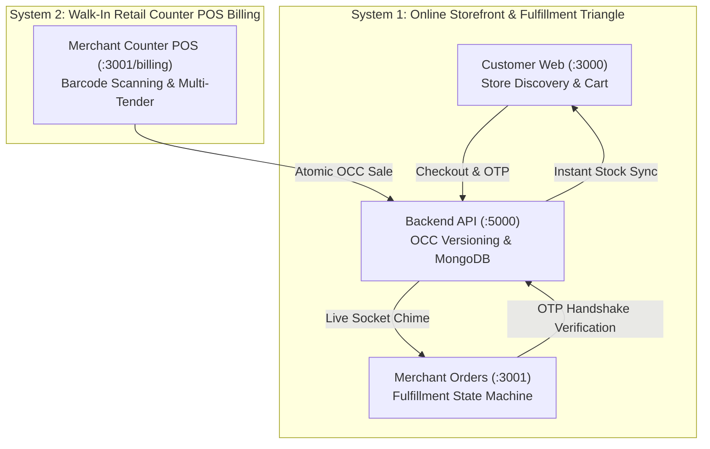

# 🚀 Platform End-to-End Staging & Operational Testing Playbook
**Document Version:** `1.0.0-PROD`  
**Classification:** Internal QA & Product Acceptance Testing  
**Target Environments:** Cloud Staging & Production (`Vercel` Web & Merchant, `Render` Backend)  
**Authoritative Scope:** 7 Core E2E Hyperlocal Commerce Workflows + Production Labs Architecture  

---

## 📋 Executive Overview & System Topology

The platform operates as a unified, dual-system hyperlocal commerce engine designed for Indian retail stores operating within a **3–4 km delivery radius**:



* **System 1 (Online Storefront & Fulfillment Triangle):** Customer discovery, single-store cart enforcement, checkout in Bhilai, real-time merchant order reception with audio chimes, runner dispatch, and secure 4-digit Delivery OTP handshake.
* **System 2 (In-House Retail Counter POS Billing):** High-speed counter barcode/SKU checkout, walk-in customer registration, multi-tender cash calculation with change return, 80mm ESC/POS thermal receipt printing, and real-time inventory deduction reflected instantly on the customer storefront.

---

## 🧪 Master 7-Step Verification Workflow

Follow these exact steps in sequence to verify the end-to-end operational integrity of the platform:

---

### 🏁 Step 1: Merchant & Store Digital Onboarding
**Target Route:** `http://localhost:3001/?view=onboarding` *(or Merchant Staging URL)*  
**Objective:** Complete the 6-step paperless registration wizard and establish cloud store identity.

1. **Mobile & Email Verification (Step 1):**
   * **Mobile Number:** `9876543210` (Click *Send OTP*, enter `1234` or demo OTP).
   * **Email Address:** `test.merchant@example.com` (Click *Send OTP*, enter `1234`).
   * **Password:** `Password@123` (Enforces 8+ characters, uppercase, and special character).
   * *Under the hood:* Creates authenticated user session with JWT Bearer access & refresh tokens.
2. **Business Identity & Legal Compliance (Step 2):**
   * **GSTIN:** `29ABCDE1234F1Z5` (Auto-validates Indian 15-character format and extracts PAN `ABCDE1234F`).
   * **Legal Business Name:** `National Retail Store Ltd.`
3. **Electronic Signature (Step 2 Sub-step):**
   * Draw digital merchant signature on the HTML5 interactive canvas or select cursive font generator. Click *Save Signature*.
4. **Store Profile & Geolocation (Step 3):**
   * **Store Display Name:** `National Retail Store`
   * **Category:** `Fashion & Apparel`
   * **Physical Address:** `123 Main Street, Commercial Center, Bhilai - 452001`
   * **Store Coordinates:** `[81.3854, 21.2132]` (Drop pin on map).
   * **Operating Schedule:** Monday–Sunday, `09:00 AM – 09:00 PM` (All days active).
5. **Bank Settlement Account (Step 4):**
   * **Account Number:** `123456789012`
   * **Confirm Account Number:** `123456789012`
   * **IFSC Code:** `HDFC0001234`
6. **Submission & Verification:**
   * Click **Submit Application**.
   * The application transitions to the **Review & Verification Room**. Click **"Preview Merchant Dashboard"** to enter the operational management interface.

---

### 🏁 Step 2: Store Status & Operational Readiness
**Target Route:** `http://localhost:3001/`  
**Objective:** Confirm store active toggle, cloud synchronization, and multi-tenant context.

1. **Store Header Toggle:**
   * Look at the top-right header: Verify store profile displays `National Retail Store`.
   * Observe the **Store Status Pill** (Green = *Store Open & Accepting Orders*, Red = *Store Closed*).
2. **Persistence Check:**
   * Toggle the switch: Confirmation dialog updates `isActive` in MongoDB Atlas via `PATCH /api/v1/stores/:id`.
   * Refresh the browser: Status persists seamlessly without reset.

---

### 🏁 Step 3: Product Catalog Creation & Multi-Variant Matrix
**Target Route:** `http://localhost:3001/catalog`  
**Objective:** Publish polymorphic retail products with size/color variants and high-res imagery.

1. Click **+ Add Product** button (top right).
2. **Product 1 (Anchor Product):**
   * **Title:** `Classic Cotton Polo T-Shirt`
   * **Category:** `Men` ➔ Sub-category: `Topwear` ➔ Type: `Polo T-Shirts`
   * **Brand:** `Polo Club`
   * **Pricing:** Selling Price: `₹799`, MRP: `₹1,299` (Auto-calculates **38% OFF** discount badge).
   * **Variants Enabled:** Check *This product has size/color variants*.
     * Generate matrix: Sizes `S, M, L, XL` with Color `White`.
     * Anchor Variant SKU: `POLO-WHT-M`, Opening Stock: `45` units.
   * **Media Upload:** Drop product photograph or paste direct image URL.
   * Click **Publish Product**.
3. **Verify Catalog Table:**
   * Confirm the product appears with live thumbnail, price `₹799`, total stock `45`, and active status badge.

---

### 🏁 Step 4: Inventory Management & Stock Adjustment
**Target Route:** `http://localhost:3001/inventory`  
**Objective:** Verify stock valuation, low-stock threshold triggers, and audit logging.

1. **KPI Summary Bar:**
   * Confirm **Total SKUs**, **Total Stock Units**, and **Stock Valuation (₹)** dynamically reflect published catalog products.
2. **Single Product Adjustment:**
   * Locate `Classic Cotton Polo T-Shirt` (`POLO-WHT-M`).
   * Click the row action menu (`⋮`) ➔ Select **Adjust Stock**.
   * Use stepper or manual entry (`+5` / `-5`), select reason (*Physical Count Reconciliation*), and save.
   * Click **Stock History** drawer to observe the immutable audit trail with timestamp and reason.

---

### 🏁 Step 5: Customer Discovery, Single-Store Cart & Checkout
**Target Route:** `http://localhost:3000` *(Customer Web Storefront)*  
**Objective:** Verify hyperlocal store discovery, single-store cart enforcement, and order placement.

1. **Customer Authentication:**
   * Click **Login / Register** in header.
   * Enter Customer Name: `Pooja Sharma`, Phone: `9876501234`, Email: `pooja.customer@example.com`, Password: `Password@123`.
   * Header displays authenticated profile: `Pooja Sharma - Sector 6, Bhilai`.
2. **Hyperlocal Store Discovery:**
   * Navigate to **Stores** (`/stores`).
   * Locate `National Retail Store` (Commercial Center, Bhilai) with verified retailer badge.
   * Click store card to open storefront catalog (`/stores/national-retail-store-oqrk`).
3. **Product Page & Cart:**
   * Select `Classic Cotton Polo T-Shirt`.
   * Verify price `₹799` (inclusive of all taxes), MRP `₹1,299`, and select size `M`.
   * Click **Add to Cart**. Floating cart badge updates to `1`.
   * *(Single-Store Invariant):* Adding an item from any other store triggers a confirmation modal to clear the existing cart.
4. **Checkout Experience (`/checkout`):**
   * **Delivery Address:** `Plot 14, Nehru Nagar West, Bhilai, Chhattisgarh - 490020`.
   * **Payment Method:** Select **Cash on Delivery (COD)**.
   * **Order Summary:** Subtotal `₹799.00` + 5% GST `₹39.95` = **Grand Total: ₹838.95**.
   * Click **Place Order**.
5. **Success Screen (`/checkout/success`):**
   * Confirms Order Number: `#ORD-20261015-CABA79`.
   * Displays 4-digit confidential customer handover **Delivery OTP** (e.g. `5575`).

---

### 🏁 Step 6: Merchant Order Fulfillment & Delivery OTP Lifecycle
**Target Route:** `http://localhost:3001/orders`  
**Objective:** Verify real-time Socket.io order alerts, pipeline progression, OTP verification, and tax invoice generation.

1. **Audible Order Alert & New Orders Tab:**
   * Upon customer checkout, the merchant dashboard plays a 2-tone melodic chime (D5 ➔ A5) and displays an arrival toast.
   * Order appears under the **New Orders** tab (`ORD-20261015-CABA79` | `₹838.95` | `Pooja Sharma`).
2. **State Machine Pipeline Progression:**
   * **Step A (Accept):** Click **Accept Order**. Order moves from `PENDING` ➔ `CONFIRMED` (*Accepted* tab).
   * **Step B (Pack):** Click **Ready to Ship**. Order moves to `PACKED` (*Ready to Ship* tab).
   * **Step C (Dispatch):** Click **Mark Shipped**. Generates tracking ID (`TRK-650493`), assigns local delivery partner, and moves to `OUT_FOR_DELIVERY` (*Shipped* tab).
3. **Delivery Handshake OTP Handover:**
   * On the *Shipped* tab, click **Verify Delivery OTP**.
   * A modern 4-digit PIN dialog opens. Enter customer's OTP: **`5575`**.
   * Click **Verify & Mark Delivered**.
   * The modal validates against the backend (`POST /api/v1/orders/:id/verify-otp`). Order transitions to **`DELIVERED`**.
4. **Tax Invoice Verification:**
   * Open the delivered order detail: Click **View Invoice**.
   * Displays legal Indian Tax Invoice `INV-ORD-20261015-CABA79` with seller GSTIN, customer details, CGST (2.5%) `₹19.98`, SGST (2.5%) `₹19.97`, and Total `₹838.95`.
5. **Atomic Stock Decrement Verification:**
   * Product `Classic Cotton Polo T-Shirt` (`POLO-WHT-M`) stock automatically decremented from **45 down to 44 units** in MongoDB Atlas.

---

### 🏁 Step 7: In-House Retail Counter POS Billing (System 2 Test)
**Target Route:** `http://localhost:3001/billing`  
**Objective:** Test walk-in retail counter sales, multi-tender cash change calculation, ESC/POS 80mm thermal receipt printing, and real-time storefront inventory deduction.

1. **Launch Counter POS Register:**
   * On the Billing page, click the **Quick Counter POS** action button (`Zap` icon) or navigate to `/billing?view=pos_counter`.
   * Enters the fullscreen cashier workstation.
2. **Fast Barcode / SKU Scan Station:**
   * Focus is automatically placed on the barcode search input.
   * Scan barcode or type `POLO-WHT-M` and hit `Enter`.
   * Audio chime sounds and `Classic Cotton Polo T-Shirt` (Variant: `POLO-WHT-M`, ₹799) is added to the bill cart.
3. **GST Tax Calculation & Customer Info:**
   * Tax breakdown auto-calculates intra-state GST: CGST 9% (`₹71.91`) + SGST 9% (`₹71.91`), Grand Total = **`₹942.82`**.
   * Enter walk-in retail customer details: Name: `Rahul Verma`, Phone: `9826112345`.
4. **Multi-Tender Cash Settlement:**
   * Select **Cash** tender mode.
   * Click the **`₹1,000`** quick cash note pill or enter `1000` in the Tendered Cash input.
   * Observe the live mathematical calculation: **Change to Return: `₹57.18`**.
5. **Complete POS Sale & Thermal Slip Generation:**
   * Click **Complete Sale & Print** (`POST /api/v1/billing/pos/sale`).
   * The sale is processed with Optimistic Concurrency Control (OCC) and issues sequential invoice **`INV-1001`** (or `INV-1002`).
   * The **ESC/POS 80mm Thermal Receipt Modal** opens automatically with store header, cashier attribution, itemized lines, GST slab breakdown, and print action.
6. **Cross-App Zero-Lag Stock Sync Verification:**
   * **MongoDB Atlas:** Variant `POLO-WHT-M` stock is atomically decremented from **44 down to 43 units**, and total product stock from **43 down to 42 units**.
   * **Customer Web Storefront (`http://localhost:3000`):** Refresh the product page (`/products/classic-cotton-polo-t-shirt-yas6y`) or query the API.
   * Instantly reflects **Total Stock: `42`, Size M Stock: `43`** with zero caching lag!

---

## 🔬 "Production Labs" Sidebar Modules — Product Roadmap & Rollout Schedule

When exploring the Merchant Management Portal (`apps/merchant`), you will notice a dedicated **"Production Labs"** section in the lower sidebar containing several advanced business modules:

```text
├── CORE COMMERCE (100% Production Ready)
│   ├── Orders Pipeline & Delivery OTP
│   ├── Product Catalog & Variant Wizard
│   ├── Inventory Management & Stock History
│   ├── Billing & Invoicing (Counter POS + Thermal Engine)
│   ├── Customers CRM & Khata Credit Ledger
│   └── Store Settings & Profiles
│
└── 🧪 PRODUCTION LABS (Iterative Rollout Roadmap)
    ├── 👛 Wallet Hub & Merchant Payout Sweeps
    ├── 📦 Purchase Orders & Operating Expenses ERP
    ├── ↩️ Automated Returns & Reverse Logistics
    ├── 📢 Marketing Suite, Banners & Coupon Creator
    └── 👥 Staff Management & Multi-Cashier RBAC
```

### Why are these placed in Production Labs?
1. **Tiered Rollout Strategy:**
   * **Tier 1 & Tier 2 Launch Core (Now Active):** The priority is live retail hyper-local discovery, walk-in counter POS billing, physical store inventory synchronization, and the online purchase-to-delivery loop. This foundation is 100% hardened and operational.
2. **Upcoming Release Sprints:**
   * The modules under **Production Labs** are actively engineered and will be unlocked progressively in targeted weekly updates:

| Module in Labs | Scheduled Milestone | Description & Business Capability |
|---|:---:|---|
| **👛 Wallet Hub & Instant Sweeps** | Sprint 2.1 (Late Oct) | Razorpay/Cashfree payout gateway integration, automated T+1 bank clearing, and on-demand wallet withdrawals. |
| **📦 Purchase Orders & Expenses** | Sprint 2.2 (Early Nov) | Supplier vendor directory, raw material Purchase Bills, and operating expense vouchers (Rent, Electricity, Logistics). |
| **↩️ Automated Reverse Logistics** | Sprint 2.3 (Mid Nov) | Customer photographic return requests, merchant inspection approval, and automated restocking hooks. |
| **📢 Marketing & Ad Campaigns** | Sprint 3.1 (Late Nov) | Store banner slider manager, sponsored search placements, and interactive voucher ticket discount wizards. |
| **👥 Staff Management (RBAC)** | Sprint 3.2 (Dec) | Granular cashier vs store manager roles with restricted POS permissions and PIN-locked registers. |

> **QA Note for Evaluators:**  
> When testing staging, focus primarily on the **Core Commerce** navigation items (Dashboard, Orders, Catalog, Inventory, Billing & Invoicing, Customers, Settings). The Production Labs modules provide structural previews and will transition into active testing as their backend service integrations reach completion.

---

## 🛠️ Staging Verification Quick-Reference Data

| Entity | Field | Value for Testing |
|---|---|---|
| **Merchant Credentials** | Email / Password | `test.merchant@example.com` / `Password@123` |
| **Merchant Mobile** | Mobile / OTP | `9876543210` / `1234` |
| **Store Entity** | Name / Category | `National Retail Store` / `Fashion` |
| **Store Location** | Address / PIN | Commercial Center, Bhilai - 452001 (`[81.3854, 21.2132]`) |
| **Customer Credentials** | Email / Password | `pooja.customer@example.com` / `Password@123` |
| **Customer Mobile** | Mobile / OTP | `9876501234` / `1234` |
| **Delivery Address** | Full Address | Plot 14, Nehru Nagar West, Bhilai, Chhattisgarh - 490020 |
| **POS Customer** | Name / Mobile | `Rahul Verma` / `9826112345` |
| **Anchor Product** | Title / Variant | `Classic Cotton Polo T-Shirt` (`POLO-WHT-M`, ₹799) |

---

## ✅ Summary of Verification Success Criteria

A full operational verification is considered **100% PASSED** when:
* [x] A merchant can register, upload products, and set active store status.
* [x] A customer can discover the store, add items, and place a COD order.
* [x] The merchant receives real-time audio/visual alert, packs, and verifies the runner with Delivery OTP.
* [x] A physical walk-in sale at the POS register calculates cash change and prints an 80mm thermal receipt.
* [x] Both online and counter sales immediately decrement inventory across the platform with zero discrepancy.
