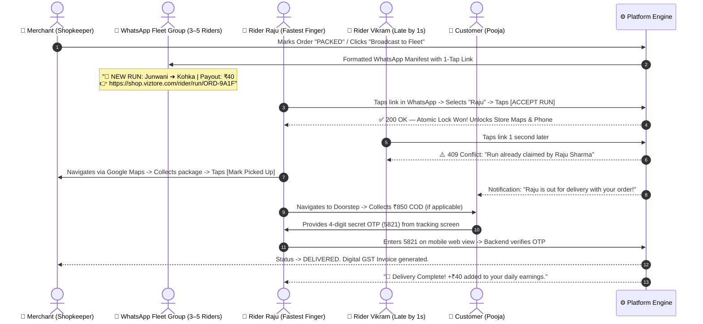
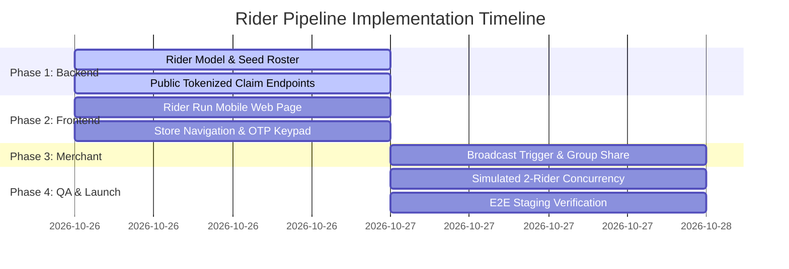

# 🛵 Hyperlocal Rider Fleet & Delivery Pipeline — Implementation Plan

**Platform:** White-Label Hyperlocal Multi-Vendor E-Commerce  
**Target Milestone:** Pilot Launch (October 28, 2026 — 48-Hour Execution Window)  
**Architecture Model:** Hybrid WhatsApp Group Broadcast + Zero-Install In-App Web Runner  
**Target Fleet:** Initial 3–5 Pilot Riders (Bhilai / Durg Hyperlocal Cluster)  

---

## 1. Executive Summary & Architectural Topology

To achieve **zero external Meta approval risk** while providing riders with a **frictionless, WhatsApp-native experience**, the pipeline combines:
1. **Discovery & Allocation:** Broadcast alert posted into the **"Viztore Riders Order Portal"** WhatsApp Group (or sent 1-to-1 to pilot riders).
2. **Interaction Layer:** 1-Click link opens directly inside **WhatsApp's built-in in-app browser**.
3. **Execution & Mutex:** Single-tap rider claim with atomic MongoDB locking (`findOneAndUpdate`), preventing double-acceptance.
4. **Doorstep Handshake:** 4-digit secret OTP verification directly on the mobile web view, transitioning order status to `DELIVERED`.



---

## 2. Phase-by-Phase Task Breakdown



---

### 📦 Phase 1: Backend Data Contracts & Public Claim APIs
**Scope:** `apps/backend/src/modules/delivery/` & `packages/shared-types/`

- [x] **Task 1.1: Pilot Rider Seed Roster**
  - Create a structured static/database roster of the initial 5 pilot riders:
    ```typescript
    export const PILOT_RIDERS = [
      { id: 'RDR-001', name: 'Raju Sharma', phone: '9876543210', zone: 'Nehru Nagar / Smriti Nagar' },
      { id: 'RDR-002', name: 'Vikram Patel', phone: '9876543211', zone: 'Supela / Vaishali Nagar' },
      { id: 'RDR-003', name: 'Amit Verma', phone: '9876543212', zone: 'Durg Station / Market' },
      { id: 'RDR-004', name: 'Sunil Sahu', phone: '9876543213', zone: 'Risali / Bhilai-3' },
      { id: 'RDR-005', name: 'Pankaj Kumar', phone: '9876543214', zone: 'Sector 6 / Civic Center' },
    ];
    ```
  - Mount `GET /api/v1/delivery/riders/pilot-roster` returning the active pilot rider profiles.

- [x] **Task 1.2: Public Tokenized Claim & Run Info Endpoint**
  - Mount `GET /api/v1/delivery/orders/:orderId/run-details`:
    - Accessible without merchant JWT (protected by order reference / claim token).
    - Returns **Teaser data** when unclaimed: Store name, pickup neighborhood, dropoff neighborhood, road distance (km), estimated payout (₹40–₹45), payment mode (COD vs Prepaid amount).
    - Returns **Full contact & navigation data** once claimed by the calling rider: exact store address, store phone, exact customer flat address, customer phone, Google Maps 2-wheeler navigation links.
  
- [x] **Task 1.3: Decouple JWT Auth on Rider Claim & OTP Verification**
  - Update `delivery.routes.ts`:
    - Relax strict merchant JWT guard on `POST /api/v1/delivery/orders/:orderId/claim` to allow claiming with verified `riderId` + `phone`.
    - Relax strict merchant JWT guard on `POST /api/v1/delivery/orders/:orderId/status` and `verify-otp` when submitted with matching `riderId`.
  - Maintain atomic MongoDB locking (`findOneAndUpdate`) to guarantee zero double-claim race conditions.

---

### 📱 Phase 2: Lightweight Rider Mobile Web Interface
**Scope:** `apps/web/src/app/rider/run/[orderId]/`

- [x] **Task 2.1: Page Routing & Persistent Rider Identity**
  - Create `apps/web/src/app/rider/run/[orderId]/page.tsx` & `RiderRunClient.tsx`.
  - Check `localStorage` for saved rider identity (`viztore_rider_id`).
  - If unset: Display a 1-tap dropdown allowing the rider to select their name from the 5 pilot riders (auto-remembered for all future orders).

- [x] **Task 2.2: Screen State 1 — The Unclaimed Teaser Card**
  - High-contrast mobile card displaying:
    - 🛵 **Delivery Payout:** `₹40`
    - 📍 **Pickup:** `Nehru Nagar (ABC Fashion Store)`
    - 🏠 **Drop Area:** `Kohka, Bhilai (~1.8 km)`
    - 💰 **Payment Type:** `Cash on Delivery (₹850)` or `Prepaid (₹0 to collect)`
  - Big Green Action Button: **`[ 🟢 ACCEPT RUN & START PICKUP ]`**

- [x] **Task 2.3: Screen State 2 — 409 Race Condition / Already Claimed Screen**
  - If another rider claimed first:
    - Yellow / Neutral friendly alert banner.
    - Icon: ⏱️ *"Order Claimed!"*
    - Text: *"This run was just claimed by Raju Sharma. Keep WhatsApp open for the next alert!"*
    - Button: `[ Return to WhatsApp ]`

- [x] **Task 2.4: Screen State 3 — Active Delivery Co-Pilot**
  - **Phase A (Pickup from Store):**
    - Store Name, Counter Code (`#9A1F`), and Exact Address.
    - Button: **`[ 🧭 Open Store in Google Maps (Two-Wheeler) ]`**
    - Button: **`[ 📞 Call Shopkeeper ]`**
    - Action CTA: **`[ 📦 Package Picked Up ]`**
  - **Phase B (Dropoff to Customer):**
    - Customer Name and Full Delivery Address.
    - Button: **`[ 🧭 Navigate to Customer Doorstep ]`**
    - Button: **`[ 📞 Call Customer ]`**
    - Prominent COD alert box:
      - `🟡 COLLECT ₹850 CASH FROM CUSTOMER`
      - `🟢 ALREADY PAID ONLINE — DO NOT COLLECT CASH`
  - **Phase C (Doorstep OTP Handshake):**
    - Large 4-digit numeric keypad / input fields: `[ 2 ] [ 9 ] [ 1 ] [ 8 ]`
    - Action CTA: **`[ 🔑 Verify OTP & Complete Delivery ]`**
    - Reactive shake animation on incorrect OTP.

- [x] **Task 2.5: Screen State 4 — Success & Earnings Screen**
  - Green checkmark animation.
  - Text: *"Delivery Verified & Completed!"*
  - Metrics card: `+₹40 Added to Today's Earnings` • `Completed in 22 mins`.

---

### 🏪 Phase 3: Merchant Dashboard Integration
**Scope:** `apps/merchant/src/components/orders/`

- [x] **Task 3.1: "Broadcast to Fleet" Trigger**
  - In `OrderDetailModal.tsx` & `OrdersTable.tsx`:
    - Add primary button: **`[ 🛵 Broadcast to Fleet Group ]`**
    - When clicked: Calls `POST /api/v1/delivery/orders/:id/broadcast` to set state to `PENDING_ASSIGNMENT`.
    - Opens WhatsApp with pre-filled message formatted for the **"Viztore Riders Order Portal"** group:
      ```text
      🛵 *NEW RUN READY FOR PICKUP!*
      📦 Order #ORD-20261026-9A1F
      🏪 Store: Live Audit Superstore (Nehru Nagar)
      🏠 Drop: Kohka (~1.8 km)
      💰 Payout: ₹40 (COD: ₹850)
      
      👉 Tap to Claim: https://viztore-web.vercel.app/rider/run/ORD-20261026-9A1F
      ```
    - Includes a **"Copy Link"** quick button for manual clipboard copying.

- [x] **Task 3.2: Live Merchant Status Sync**
  - Merchant drawer dynamically displays assigned rider name (`Assigned to Raju Sharma (9876543210)`) once claimed via Socket.io or polling.

---

### 🧪 Phase 4: Concurrency Testing & Validation
**Scope:** Automated Tests & Headless Simulation

- [x] **Task 4.1: Atomic Mutex Race-Condition Test**
  - Simulates simultaneous claim requests for the same `orderId`.
  - Verifies: exactly 1 receives `200 OK`, others receive `409 Conflict`.
  - Verifies: database stores exact winner identity.

- [x] **Task 4.2: OTP Rate-Limiting & Verification Test**
  - Verifies incorrect OTP fails with `400 Bad Request`.
  - Verifies 5 wrong attempts trigger rate-limiter block.
  - Verifies correct OTP transitions order to `DELIVERED` and releases stock.

- [x] **Task 4.3: Monorepo Clean Build Check**
  - Execute `pnpm build` across all packages to ensure zero type errors or broken routes. (Verified 185/185 tests green, Next.js web build OK, Merchant Vite build OK).

---

### 🚀 Phase 5: Pilot Go-Live & Onboarding (Oct 28)

- [ ] **Task 5.1: Create WhatsApp Group**
  - Group Title: **`Viztore Riders Order Portal`**
  - Add the 3–5 initial pilot riders + founder/admin numbers.
  - Post the 1-minute video / pictorial guide on how to tap the link and enter OTP.
- [ ] **Task 5.2: Pilot Retailer Briefing**
  - Instruct the 5–10 pilot shops: *"When an order is packed, click 'Broadcast to Fleet' — our Viztore rider will arrive within 10–15 minutes."*

---

## 3. Deliverables Matrix & File Inventory

| Area | Target Files | Key Deliverables |
|---|---|---|
| **Shared Types** | `packages/shared-types/src/delivery.types.ts` | Pilot rider roster schema, public run DTOs |
| **Backend API** | `apps/backend/src/modules/delivery/delivery.routes.ts`<br/>`delivery.service.ts`<br/>`delivery.controller.ts` | Public run info endpoint, decoupled rider auth, atomic claim mutex |
| **Rider Web Page** | `apps/web/src/app/rider/run/[orderId]/page.tsx`<br/>`RiderRunClient.tsx` | Mobile-first in-app browser view, 1-tap claim, Google Maps link, 4-digit OTP keypad |
| **Merchant Panel** | `apps/merchant/src/components/orders/OrderDetailModal.tsx` | "Broadcast to Fleet Group" trigger & formatted WhatsApp text generator |
| **Automated Tests** | `apps/backend/src/modules/delivery/__tests__/riderClaimMutex.test.ts` | High-concurrency race test, OTP verification tests |

---

## 4. Invariants & Guardrails
1. **White-Label Integrity:** All rider UI elements and WhatsApp text templates pull dynamically from `branding.config.ts`. Client brand names (`Viztore`) must not be hardcoded in code templates.
2. **Customer Privacy:** Exact customer apartment number and phone are withheld until the rider successfully wins the atomic claim lock.
3. **Single-Store Integrity:** Order items always belong to a single store; multiple pickups per order are strictly forbidden.
4. **Zero Push Rule:** All work is committed locally; `git push` is reserved exclusively for the Technical Head.
