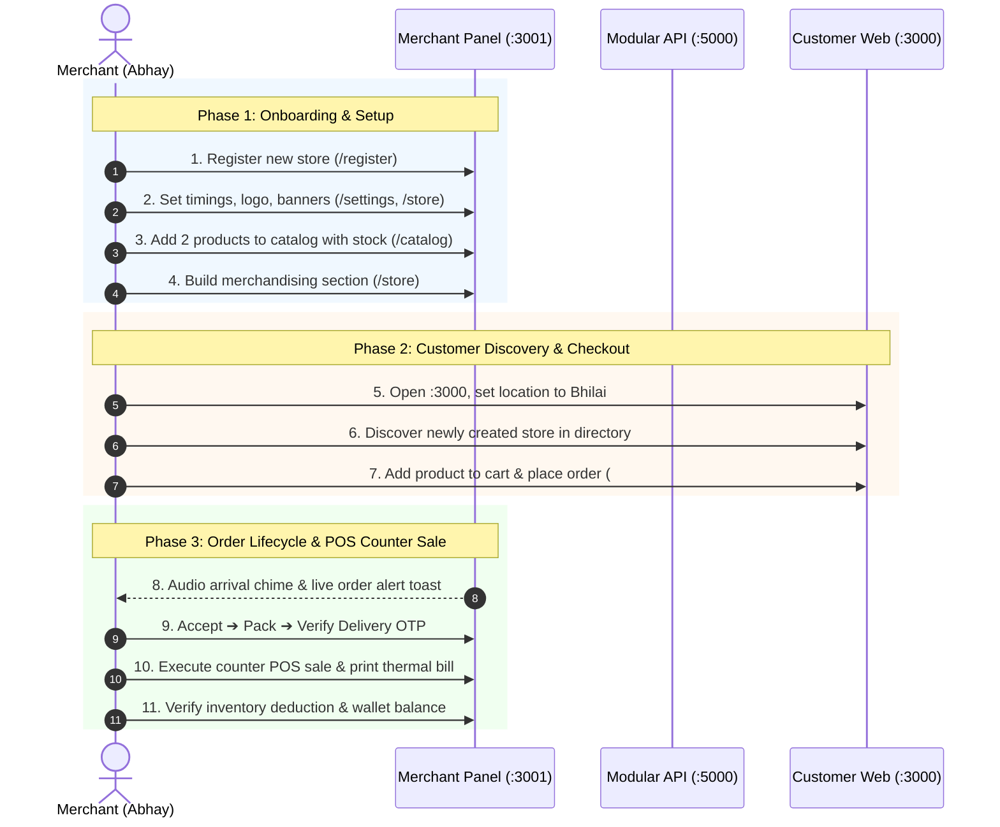

# 🧪 Merchant Portal: End-to-End Operational Lifecycle & Cross-Platform Simulation Task (`TASK-ABH-11`)

**Assignee:** Abhay ([`@Abhay0410`](https://github.com/Abhay0410))  
**Target Workspaces:** `apps/merchant/` (React 18 + Vite Merchant Panel) & `apps/web/` (Next.js 14+ Customer Storefront)  
**Deliverable Document:** `apps/merchant/MERCHANT_E2E_QA_AUDIT_REPORT.md` (or submitted PR/Issue report)  
**Assigned Date:** October 12, 2026  
**Target Delivery Window:** 2 Working Days (48 Hours)  
**Status:** `ASSIGNED` 🟡  
**Target Environments:**
1. **Desktop Browser** (Chrome/Brave/Edge/Safari at $\ge 1280\text{px}$ viewport)
2. **Local Development Servers**:
   - Backend API: `http://localhost:5000`
   - Merchant Panel: `http://localhost:3001`
   - Customer Web: `http://localhost:3000`

---

## 🎯 Executive Overview & Mission

You have engineered all 15 operational modules of the **Merchant Application Suite** and completed the **E2E Polish (PR #17)**. Now, before our release milestone, you are stepping into your first **Lead QA & Full-Lifecycle System Simulation Role** as the lead merchant engineer.

Your mission is to perform an exhaustive, real-time manual test of the entire platform loop:
1. **Track A: Merchant Registration & Store Setup**:
   - Register a brand-new merchant from scratch through the 4-step onboarding pipeline.
   - Complete store profile, store hours, logo/banner branding, and store active status controls.
2. **Track B: Catalog Building & Merchandising**:
   - Ingest live products using the 3-step Add Product Wizard with barcodes and stock quantities.
   - Create storefront display sections with live phone chassis preview and inspect inventory ledgers.
3. **Track C: Customer Discovery & Order Placement (Cross-Platform Loop)**:
   - Switch to the customer web storefront (`localhost:3000`), set delivery location to Bhilai, discover your newly created store, and place an order.
4. **Track D: Live Order Fulfillment & POS Counter Billing**:
   - Switch back to the merchant panel (`localhost:3001`), verify the real-time incoming order chime/alert, and advance the order through the state machine using the Delivery OTP handoff.
   - Execute an in-house walk-in POS billing sale and verify thermal/A4 receipt printing and financial ledgers.

---

## 🔄 End-to-End Simulation Lifecycle

---

## 📋 Granular Step-by-Step Test Protocol

### 🏬 Track A: Merchant Registration, Setup & Merchandising

#### Step 1: Merchant Registration & Onboarding (`/register` / `/onboarding`)
* **URL**: `http://localhost:3001/register`
* **Test Actions**:
  1. Click "Start Selling" or navigate to `/register`.
  2. **Step 1 (Mobile & Email)**: Enter a fresh 10-digit mobile number and business email. Verify OTP state transition.
  3. **Step 2 (ID Verification)**: Enter a valid 15-character GSTIN (e.g. `22AAAAA0000A1Z5`) and 10-character PAN (`ABCDE1234F`). Test validation error triggers on malformed inputs. Draw an e-signature on the canvas.
  4. **Step 3 (Store Details & Map Picker)**:
     - Store Name: e.g. `Bhilai Handloom Emporium`.
     - Category: Fashion & Apparel.
     - Map Pin: Place pin in Bhilai (Pincode: `490006`). Delivery Radius: `3.5 km`.
  5. **Step 4 (Bank Account)**: Enter Account Number and IFSC (`HDFC0001234`).
  6. Submit registration and verify transition to the Review / Dashboard page.

#### Step 2: Store Appearance & Operational Controls (`/settings` & `/store`)
* **Test Actions**:
  1. **Store Status Toggle**: Test the Header status switch:
     - Toggle from `Store Active ●` (green) to `Store Inactive ●` (red).
     - Verify `StoreInactiveConfirmModal` opens with correct warning copy.
     - Confirm inactive state and check sticky warning banner.
     - Toggle back to `Store Active ●`.
  2. **Store Timings (`/settings` -> Timings)**: Set operational hours (e.g. 10:00 AM – 09:30 PM, Monday–Sunday).
  3. **Banner & Logo (`/store` -> Manage Banner & Logo)**:
     - Upload or select store logo (512×512) and desktop/mobile promotional banners.
     - Inspect right-column live customer phone chassis frame for visual layout.
  4. **My Store QR & Link (`/store` -> My Store QR & Link)**:
     - Inspect generated QR code standee preview.
     - Test "Copy Link" button (verify clipboard payload format: `http://localhost:3000/stores/<slug>`).

#### Step 3: Product Ingestion & Inventory Setup (`/catalog` & `/inventory`)
* **Test Actions**:
  1. **Add Product 1**:
     - Name: `Handloom Cotton Kurta - Indigo Blue`.
     - Category: `Men Fashion` ➔ `Ethnic Wear`.
     - Price: ₹`899`, MRP: ₹`1,499`.
     - Stock: `15` units. SKU: `PRD-KURTA-BLU-M`.
     - Barcode: `8901234567890`.
     - Step 4: Inspect barcode sticker preview and submit.
  2. **Add Product 2**:
     - Name: `Embroidered Chanderi Dupatta`.
     - Price: ₹`499`, MRP: ₹`999`. Stock: `10` units. SKU: `PRD-DUP-GLD`.
  3. **Inventory Audit (`/inventory`)**:
     - Verify both products appear with correct stock and status badges.
     - Test "Adjust Stock" drawer on Product 1: increment stock by `+5` (New Total: `20`). Verify live recalculation.
  4. **Merchandising Shelf (`/store` -> Store Sections)**:
     - Click "Add New Section". Name: `Festive Highlights`.
     - Assign both products via checkbox table.
     - Verify section order and live mobile phone preview.

---

### 🛒 Track B: Cross-Platform Customer Discovery & Purchase

#### Step 4: Hyperlocal Store Discovery on Customer Web (`:3000`)
* **URL**: `http://localhost:3000`
* **Test Actions**:
  1. Open a new incognito window or browser tab at `http://localhost:3000`.
  2. Log in as a customer or sign up (`arjun.customer@example.com` / `Password@123` or fresh test account).
  3. **Location Selector**: Set delivery location to Bhilai (Pincode `490006`).
  4. Verify your newly registered store (`Bhilai Handloom Emporium`) appears in "Stores Near You" or `/stores` directory.
  5. Click into the store storefront (`/stores/<slug>`). Verify your custom logo, banner, and `Festive Highlights` shelf.

#### Step 5: Order Placement & Single-Store Invariant
* **Test Actions**:
  1. Add `Handloom Cotton Kurta - Indigo Blue` (Qty: 2) to cart.
  2. Verify cart count badge updates in header.
  3. Navigate to `/cart`. Verify items, subtotal (2 × ₹899 = ₹1,798), taxes, and delivery fee.
  4. **Test Single-Store Invariant**: Attempt to add a product from a different store (e.g. `Urban Vogue Studio`). Verify system prompts: *"Your cart already contains items from Bhilai Handloom Emporium. Clear cart to add items from this store?"* (Verify it does NOT silently mix stores).
  5. Click "Proceed to Checkout" (`/checkout`):
     - Address: Select or enter a Bhilai address (e.g. `Flat 402, Surya Apartments, Junwani, Bhilai, 490020`).
     - Fulfillment: "Deliver to Home".
     - Payment: "Cash on Delivery".
     - Click "Place Order".
  6. **Order Confirmation**:
     - Verify Order ID format: MUST be `#ORD-xxxxx` (Never `#VZT...`).
     - Note down the **4-digit Delivery OTP** (e.g. `4821`) and Order ID.

---

### 📦 Track C: Live Order Processing & POS Counter Sale

#### Step 6: Order Fulfillment & Delivery OTP Handoff (`/orders`)
* **URL**: `http://localhost:3001`
* **Test Actions**:
  1. Switch back to Merchant Dashboard.
  2. **Incoming Order Chime**: Verify audible Web Audio melodic chime (D5 ➔ A5) triggers and amber live order toast alert appears with Order ID!
  3. Navigate to **Orders Pipeline** (`/orders`). Verify the order appears in the `Incoming (New)` tab.
  4. Open `OrderDetailModal`:
     - Inspect customer name, address, item details, and invoice summary.
     - Advance order status: Click "Accept Order" (moves to `Preparing`).
     - Click "Mark Ready" (moves to `Ready for Pickup`).
     - Click "Hand over for Delivery" (moves to `Out for Delivery`).
  5. **Delivery Verification**: Click "Complete Delivery / Verify OTP".
     - Enter the 4-digit Delivery OTP noted from the customer checkout.
     - Verify status transitions to `Completed` with green badge.
  6. **Inventory Auto-Deduction Check**:
     - Navigate to `/inventory`.
     - Verify stock for `Handloom Cotton Kurta` decreased by 2 units (from `20` to `18`).

#### Step 7: In-House Retail Counter POS & Receipt Print (`/billing`)
* **Test Actions**:
  1. Navigate to `/billing` -> **Counter POS**.
  2. **Customer Entry**:
     - Enter customer name: `Ramesh Kumar` and phone `9827155443`.
     - Verify customer state selection defaults to `Chhattisgarh`.
  3. **Cart Assembly**:
     - Search and add `Embroidered Chanderi Dupatta` (Qty: 1, ₹499).
     - Verify automatic Indian GST calculation (CGST 2.5% + SGST 2.5% or 5% tax pill).
  4. **Tender & Settle**:
     - Select payment mode: `UPI` / `Cash`.
     - Click "Charge ₹499 & Issue Bill".
  5. **Thermal Print Verification**:
     - In the Print modal, toggle to **Thermal Receipt (80mm)**.
     - Inspect store header, items table, GST breakdown, and bottom barcode.
     - Click "Print" to trigger print preview dialog.
  6. **Invoices Table Action Popover**:
     - Navigate to `/billing` -> Invoices tab.
     - Locate the generated invoice (`INV-1001`).
     - Click `More ▾` button.
     - Verify `TableActionPopover` opens cleanly without overflow clipping, clamped to viewport.
     - Test "Print Thermal (80mm)" and "Print A4 Invoice" triggers.

#### Step 8: Multi-Module Health & Financial Reconciliation
* **Test Actions**:
  1. **Wallet (`/wallet`)**: Verify available and settled balance reflects completed orders.
  2. **Expenses (`/expenses`)**: Test "Add Expense" modal (Category: Rent/Utilities, Amount: ₹5,000). Verify expense list.
  3. **Analytics (`/analytics`)**: Verify Sales Overview and Daily Revenue curves reflect today's transaction totals.
  4. **Support Desk (`/support`)**: Test "Create Support Ticket" modal with phone validation.

---

## 📝 Required Deliverable: QA Audit Report Format

Document all simulation observations, screen checks, and bug tickets in:  
**`apps/merchant/MERCHANT_E2E_QA_AUDIT_REPORT.md`**

Use this exact structure:

### 1. Executive Summary
* Date of Simulation, Tester Name, Operating System, Browser & Version.
* Tested Store Name, Seeded Customer Account, Generated Order ID.
* Overall Merchant End-to-End Grade (out of 10).

### 2. Discovered Bug & UI Discrepancy Matrix
Record every observed glitch, visual misalignment, or functional issue in this table:

| # | Screen / Route | Component / Modal | Description (Expected vs Actual) | Severity (`Critical` / `High` / `Medium` / `Low`) | Steps to Reproduce |
|---|---|---|---|:---:|---|
| 1 | `/billing` Invoices | `TableActionPopover` | Popover clips bottom edge on small screens | Low | Open more menu on last row of table |
| 2 | `/store` Sections | Phone Chassis | Missing thumbnail preview for section header | Medium | Add custom banner to section |

*Severity Guide:*
- **Critical**: Broken order state machine, checkout crash, inventory desynchronization.
- **High**: Non-functional button, broken OTP verification, missing invoice generation.
- **Medium**: Layout overflow, modal scroll locking glitch, styling discrepancy.
- **Low**: Micro-spacing inconsistency, cosmetic font padding, animation delay.

### 3. Simulation Flow Checkpoints
| Checkpoint | Status (`PASS` / `FAIL`) | Quantitative / Qualitative Notes |
|---|:---:|---|
| 1. Merchant Onboarding (4 Steps) | `PASS` | Registered store in Bhilai with valid GSTIN |
| 2. Base Store Setup & Timings | `PASS` | Set store timings & banner logo |
| 3. Catalog Ingestion & Barcodes | `PASS` | Added 2 products with 15 & 10 units |
| 4. Customer Storefront Discovery | `PASS` | Found store on `:3000` via Bhilai location |
| 5. Single-Store Cart Invariant | `PASS` | Clear-cart modal triggered when mixing stores |
| 6. Checkout & OTP Generation | `PASS` | Placed order `#ORD-xxxxx`, OTP displayed |
| 7. Socket.io Incoming Order Alert | `PASS` | Audio chime played & live toast displayed |
| 8. 4-Step Order Status Pipeline | `PASS` | Accepted, packed, and verified via OTP |
| 9. Atomic Inventory Auto-Deduction | `PASS` | Kurta stock decreased from 20 to 18 |
| 10. Counter POS & Thermal Bill Print | `PASS` | Issued `INV-1001` and verified thermal preview |
| 11. Multi-Module Financial Ledger | `PASS` | Wallet and Analytics updated |

### 4. Top Recommended UI/UX Enhancements
* Highlight 3–5 high-impact refinements to make the merchant portal experience even smoother for Indian local shopkeepers (e.g. quick keyboard shortcuts, faster search, thermal print auto-trigger).

---

## 🔒 White-Label Zero-Tolerance Reminder
> [!CAUTION]
> If you detect **ANY hardcoded client brand name** ("Viztore", "VZT") on any screen, dropdown, modal, or invoice header during your walkthrough:
> **Flag it immediately as a HIGH-SEVERITY bug** in your report! All merchant text must read from `branding.appName` and use generic prefixes (`PRD-`, `#ORD-`, `INV-`).
