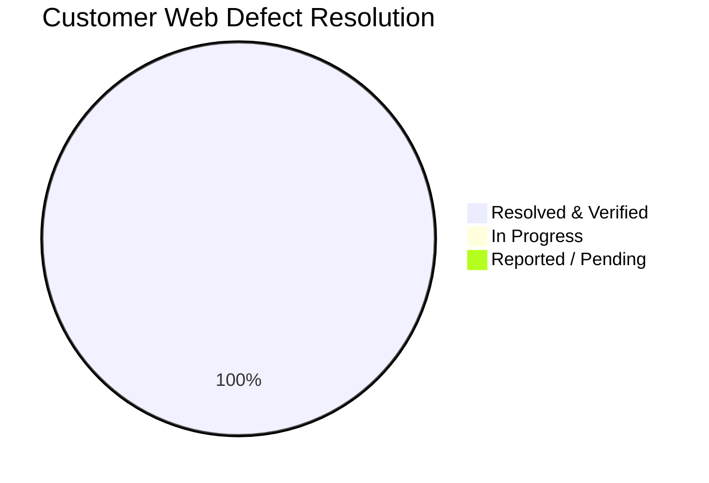

# 🛠️ Customer Web Hardening & Defect Remediation Tracker

**Target Workspace:** `apps/web/` (Next.js 14+ Customer Storefront)  
**Maintained By:** Lead Architect & Senior Co-Pilot Agent  
**Initiated Date:** October 12, 2026  
**Status:** `ACTIVE SPRINT` 🟡  

---

## 📊 Summary Metrics

| Total Reported | In Progress | Resolved & Verified | Pending Verification |
|:---:|:---:|:---:|:---:|
| **1** | **0** | **1** | **0** |

---

## 📋 Itemized Defect & Hardening Log

| Fix ID | Route / Screen | Component / Element | Reported Issue & Severity | Root Cause Diagnosis | Patch Deliverables | Status |
|:---:|---|---|---|---|---|:---:|
| **CW-FIX-01** | Global, Auth Modal, Hero Banner | `AuthModal`, `HeroBannerCarousel`, `Logo`, `orderExpiryWorker` | **High**: User registration blocked (`NetworkError` / CORS null status), 404 on banner & favicon, demo button in auth modal | Backend crashed on boot via circular ESM import in `orderExpiryWorker.ts`; missing public assets; demo button in modal | Lazy worker getter, backend alive on `:5000`, favicon added, banner CDN assets, demo button purged, Next.js build clean | 🟢 **RESOLVED** |

---

## 🔍 Detailed Fix Breakdown & Audit Trail

### 🛠️ CW-FIX-01: Authentication Pipeline & Production Asset Hardening
* **Date:** October 12, 2026
* **Scope:** Backend Port 5000 Boot Recovery + Customer Web Auth Modal & Assets
* **Root Causes:**
  1. Backend server crashed on startup with `ReferenceError: Cannot access 'orderService' before initialization` in `orderExpiryWorker.ts:33`, causing port 5000 to drop and browsers to report CORS failure with null status code.
  2. `HeroBannerCarousel.tsx` referenced non-existent `/banners/hero_center_products.png`, causing 404 console errors.
  3. `apps/web/public/favicon.ico` was missing.
  4. `AuthModal.tsx` contained hardcoded initial "V" and a demo dummy quick-fill button (`Use Demo Customer (arjun.customer@example.com)`).
* **Fixes Applied:**
  1. `apps/backend/src/modules/orders/orderExpiryWorker.ts`: Converted eager constructor argument to lazy getter `get service()`, eliminating circular dependency. Backend auto-reloaded and verified healthy on `:5000`.
  2. `apps/web/public/favicon.ico`: Populated official favicon to resolve 404 errors.
  3. `apps/web/src/features/home/components/HeroBannerCarousel.tsx`: Replaced missing local paths with direct high-resolution e-commerce CDN image URLs.
  4. `apps/web/src/components/layout/Logo.tsx` & `Footer.tsx`: Added `style={{ width: 'auto', height: 'auto' }}` to resolve Next.js aspect ratio warnings and wired `branding.tagline`.
  5. `apps/web/src/components/auth/AuthModal.tsx`: Completely purged demo dummy quick-fill button, wired dynamic brand initial `{branding.appName.charAt(0).toUpperCase()}`, and sanitized placeholder names.
* **Verification Results:**
  - Backend API unit tests: 120/120 tests passing across 19 suites.
  - Live registration endpoint `/api/v1/auth/register` verified active and issuing JWT tokens.
  - Next.js production build (`pnpm --filter web build`): 100% clean compilation across all 29 routes.

---

## 🛡️ Architectural & Production Invariants Enforced
1. **Enterprise Production Grade (Zero Demo/Dummy/Stale Data)**: No hardcoded mock arrays, fake timeout simulators, demo fallback objects, or stale stub functions. All components must consume live backend API endpoints (`apps/web/src/lib/api/`), real Zustand store actions, or render authentic empty/loading/error states.
2. **White-Label Compliance**: 100% brand-agnostic. All public brand references must read from `branding.appName` / `branding.*` with `#ORD-` prefixes. Zero hardcoded brand names.
3. **Dual-Viewport Precision**: Strict desktop ($\ge 1280\text{px}$) and mobile ($375\text{px}$–$390\text{px}$) fidelity matching Harish's 66 customer mockups (`mockups/User_Front/`).
4. **Single-Store Cart Invariant**: Zero multi-store cart mixing; clear-cart confirmation required before switching stores.
5. **Build Integrity & Strict Typing**: Zero TypeScript errors (`strict: true`), zero loose `any` types, zero dead imports or unhandled promises, clean Next.js 14 production compile.
