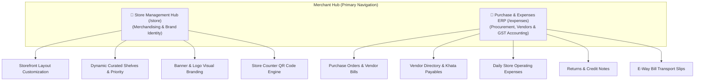
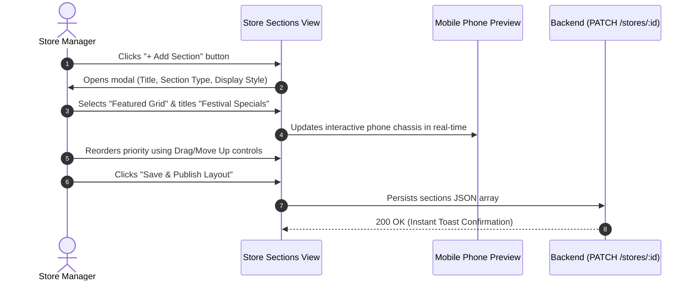
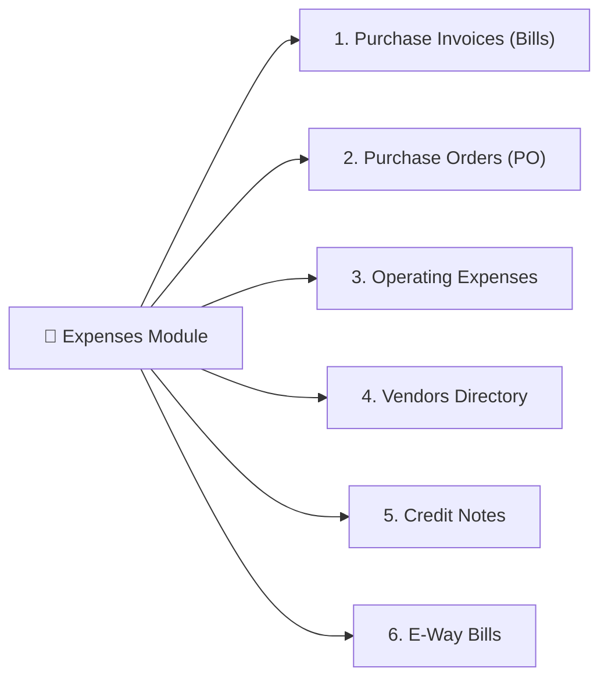
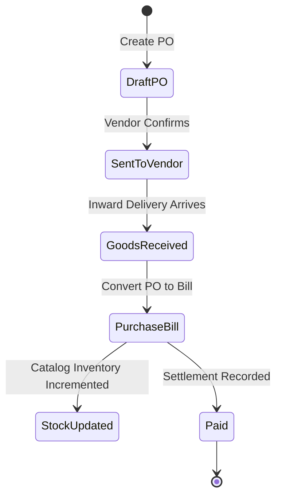
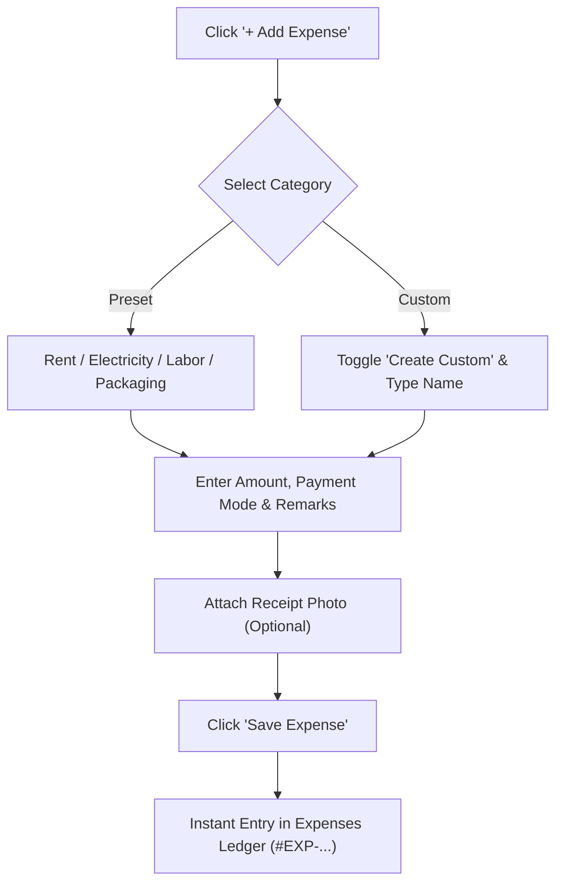

# 📖 Merchant Portal User Guide: Store Management & Purchase / Expense ERP

**Target Audience:** Merchant Store Owners, Retail Managers, Cashiers, and Operations Personnel  
**Platform Scope:** Merchant Panel (`apps/merchant/`)  
**Design & Spec Baseline:** `mockups/Merchant_Front/` Folders 8 & 13  
**Status:** Production Ready (Hardened, Tested & Live)  

---

## 📑 Table of Contents
1. [Executive Overview](#1-executive-overview)
2. [Module 1: Store Management Hub (`/store`)](#2-module-1-store-management-hub-store)
   - [2.1 Overview & Key Capabilities](#21-overview--key-capabilities)
   - [2.2 Navigating the 4 Functional Tabs](#22-navigating-the-4-functional-tabs)
   - [2.3 Step-by-Step Workflow: Customizing Storefront Sections](#23-step-by-step-workflow-customizing-storefront-sections)
   - [2.4 Step-by-Step Workflow: Managing Banners, Logos & Branding](#24-step-by-step-workflow-managing-banners-logos--branding)
   - [2.5 Step-by-Step Workflow: Generating & Printing Store QR Codes](#25-step-by-step-workflow-generating--printing-store-qr-codes)
3. [Module 2: Purchase & Operating Expense ERP (`/expenses`)](#3-module-2-purchase--operating-expense-erp-expenses)
   - [3.1 Overview & Key Capabilities](#31-overview--key-capabilities)
   - [3.2 The 6 Procurement & Expense Tabs](#32-the-6-procurement--expense-tabs)
   - [3.3 Step-by-Step Workflow A: Inward Procurement (PO ➔ Bill ➔ Stock)](#33-step-by-step-workflow-a-inward-procurement-po--bill--stock)
   - [3.4 Step-by-Step Workflow B: Recording Daily Operating Expenses](#34-step-by-step-workflow-b-recording-daily-operating-expenses)
   - [3.5 Step-by-Step Workflow C: Managing Vendors & Payables](#35-step-by-step-workflow-c-managing-vendors--payables)
   - [3.6 Step-by-Step Workflow D: Purchase Returns & Credit Notes](#36-step-by-step-workflow-d-purchase-returns--credit-notes)
   - [3.7 Step-by-Step Workflow E: Statutory E-Way Bill Generation & Printing](#37-step-by-step-workflow-e-statutory-e-way-bill-generation--printing)
4. [Keyboard Shortcuts, Tips & Best Practices](#4-keyboard-shortcuts-tips--best-practices)
5. [Frequently Asked Questions (FAQ)](#5-frequently-asked-questions-faq)

---

## 1. Executive Overview

To deliver a truly complete digital-first retail experience for Indian brick-and-mortar merchants, the platform provides two essential operational pillars in the primary navigation:

* **Store Management Hub (`/store`)**: Gives merchants full artistic and commercial control over how their digital storefront appears to nearby customers within a 3–4 km radius.
* **Purchase & Operating Expense ERP (`/expenses`)**: Equips store owners with enterprise procurement, vendor relationship management, statutory GST tax invoices, and operating expense tracking (rent, salaries, utility bills, packaging).

---

## 2. Module 1: Store Management Hub (`/store`)

### 2.1 Overview & Key Capabilities
Located directly in the main sidebar under **Store Management** (`Store` icon), this hub manages your public storefront identity:
* **Real-time Live Sync**: All updates automatically persist to the central cloud database without requiring full-page reloads.
* **WYSIWYG Mobile Preview**: See exactly how changes look inside an iPhone/Android customer viewport before publishing.
* **Vector QR Engine**: Export high-resolution store QR codes in PNG, SVG, or printable vector formats for counter tent cards and packaging stickers.

### 2.2 Navigating the 4 Functional Tabs

| Tab Name | Icon | Purpose | Mockup Screen Ref |
|---|:---:|---|:---:|
| **Storefront Overview** | `LayoutDashboard` | High-level status, live URL, visit counter, active sections count | `13.0.png` |
| **Store Sections & Layout** | `Layers` | Reorder homepage sections, toggle visibility, assign catalog items | `13.1.png`, `13.1a.png`, `13.2.png` |
| **Banner & Logo** | `Image` | Upload and preview store avatars, promotional hero banners | `13.4.png` |
| **Store QR & Links** | `QrCode` | Generate branded QR codes, copy shortlinks, download counter flyers | `13.3.png` |

---

### 2.3 Step-by-Step Workflow: Customizing Storefront Sections

#### Detailed Steps:
1. Navigate to **Store Management** ➔ Click the **Store Sections & Layout** tab.
2. **Reorder Existing Sections**:
   - Use the `↑ Move Up` and `↓ Move Down` arrows on any section card (e.g., *Best Sellers*, *Trending Now*, *New Arrivals*).
   - Higher sections appear at the top of the customer's mobile app feed.
3. **Toggle Visibility**:
   - Flip the green switch to temporarily hide seasonal shelves (e.g., *Diwali Deals*) without deleting them.
4. **Add a New Custom Section**:
   - Click the green **`+ Add Section`** button in the top toolbar.
   - Enter a **Section Title** (e.g., *Organic Spices* or *Under ₹99 Store*).
   - Choose a **Display Format**:
     - `Horizontal Carousel`: Best for quick browsing of 10+ items.
     - `2-Column Grid`: Best for visual categories like fashion and electronics.
     - `Single Banner Rail`: Best for flash deals and announcements.
   - Check the **Mobile Phone Preview** on the right side to inspect spacing.
   - Click **Add Section**.
5. **Assign Products to Section**:
   - Click the **Manage Items** button on the section card.
   - Select products from your live catalog inventory using the multi-select checkboxes.
   - Click **Save Placement**.

---

### 2.4 Step-by-Step Workflow: Managing Banners, Logos & Branding

1. Navigate to **Store Management** ➔ Click **Banner & Logo**.
2. **Store Logo / Avatar**:
   - Upload a square image (Recommended: `500 × 500 px`, PNG or JPG).
   - This appears on customer invoices, store discovery rails, and chat receipts.
3. **Storefront Hero Banner**:
   - Upload a panoramic banner (Recommended: `1200 × 400 px`).
   - Use the drag-and-drop dropzone or click to select a file.
   - The preview card shows how the banner sits behind your store title and verification badge.
4. Click **Update Visual Identity** to persist.

---

### 2.5 Step-by-Step Workflow: Generating & Printing Store QR Codes

1. Navigate to **Store Management** ➔ Click **Store QR & Links**.
2. **Shareable Shortlink**:
   - Click the `Copy` button next to your store URL (e.g., `https://{domain}/store/{store-slug}`).
   - Share directly via WhatsApp or social media.
3. **Counter Tent Card & Sticker QR**:
   - Choose your preferred export resolution:
     - **PNG**: Ideal for digital marketing, WhatsApp status, and Instagram stories.
     - **SVG**: Infinite resolution vector format for commercial banner printers.
     - **Print Table Stand**: Opens direct browser print dialog calibrated for 4×6 inch acrylic table stands.
4. Customers scan this QR code using Google Lens, Paytm, PhonePe, or Camera to immediately open your shop within their 3–4 km delivery radius.

---

## 3. Module 2: Purchase & Operating Expense ERP (`/expenses`)

### 3.1 Overview & Key Capabilities
Located under **Expenses** in the primary navigation sidebar, this module operates as a complete retail back-office ERP:
* **Procurement Lifecycle**: Tracks purchase orders (POs), inward bills, stock intake, and vendor payments.
* **Indian Statutory Tax Compliance**: Supports 15-character GSTIN validation, HSN/SAC codes, and itemized CGST/SGST/IGST breakdowns.
* **Thermal & A4 Printing**: Print procurement bills and e-way vouchers on 80mm thermal rolls or standard A4 sheets.
* **Zero Alert Interruption**: All actions use reactive modal dialogs, slide-out flyout drawers, and clean toast feedback.

### 3.2 The 6 Procurement & Expense Tabs

| Tab | Key Function | Typical Use Case |
|---|---|---|
| **Purchase Invoices** | Records tax invoices received from distributors and brands | Inward shipment received with official GST bill |
| **Purchase Orders (PO)** | Formal purchase requisitions sent to suppliers | Ordering 50 cartons of FMCG stock for next week |
| **Operating Expenses** | Tracks overhead expenses not tied to inventory purchase | Paying shop electricity, rent, labor, or packaging bags |
| **Vendors Directory** | Supplier database with GSTIN, terms, and balance payables | Looking up distributor phone, address, or credit balance |
| **Credit Notes** | Debit/credit vouchers against damaged or returned goods | Distributor refunds 5 spoiled cartons |
| **E-Way Bills** | Indian GST electronic transport permits for goods in transit | Inward freight shipments exceeding ₹50,000 threshold |

---

### 3.3 Step-by-Step Workflow A: Inward Procurement (PO ➔ Bill ➔ Stock)

#### Step 1: Create a Purchase Order (Optional, but recommended)
1. In `/expenses`, click the top-right green button **`+ Add Purchase`** ➔ Select **`Purchase Order (PO)`**.
2. Select an existing **Vendor** from the dropdown (or click `+ Add New Vendor`).
3. Enter **Expected Delivery Date** and **Payment Terms** (e.g., *Net 15*, *Net 30*, *Immediate*).
4. Add line items: SKU/Item Name, Quantity, Unit Cost, and applicable GST rate (0%, 5%, 12%, 18%, 28%).
5. Click **Create Purchase Order**. The system assigns a sequenced ID (e.g., `PO-2026-001`).

#### Step 2: Record Incoming Purchase Bill
When distributor delivery arrives at your store:
1. Click **`+ Add Purchase`** ➔ Select **`Purchase Bill`** (or open the PO and click *Convert to Bill*).
2. Enter the supplier's **Vendor Invoice Number** (from their physical paper bill).
3. Confirm the received quantities, unit costs, and tax breakdown.
4. Choose **Payment Status**: `Paid`, `Partially Paid`, or `Unpaid`.
5. Click **Save Purchase Bill**.
6. **Print Receipt**: Click `Print` on the bill drawer to generate an 80mm thermal filing slip or A4 audit voucher.

---

### 3.4 Step-by-Step Workflow B: Recording Daily Operating Expenses

Use this to track all non-inventory cash outflows to maintain true net profit calculation:

1. In `/expenses`, click the **`+ Add Expense`** button.
2. **Category Selection**:
   - Choose from standard presets: *Store Rent*, *Electricity & Utilities*, *Packaging Supplies*, *Staff Salaries*, *Delivery Logistics*, *Maintenance & Repairs*.
   - Need a new category? Click the **`+ Add Custom Category`** toggle, type the category name (e.g., *Pooja Supplies* or *Tea & Refreshments*), and it instantly becomes selectable.
3. Enter **Expense Amount (₹)** and select **Payment Mode** (*Cash*, *UPI / QR*, *Bank Transfer*, *Debit/Credit Card*).
4. Enter **Vendor / Payee Name** (e.g., *State Electricity Board* or *Landlord Name*).
5. (Optional) Drag & drop or take a photo of the physical cash voucher/bill.
6. Click **Save Expense Record**. The record appears immediately in your ledger with a tracked `#EXP-...` voucher number.

---

### 3.5 Step-by-Step Workflow C: Managing Vendors & Payables

1. Navigate to `/expenses` ➔ Click the **Vendors Directory** tab.
2. **Vendor Metrics Bar**:
   - Inspect **Total Active Vendors**, **Total Outstanding Payables (₹)**, and **Overdue Bills**.
3. **Adding a New Supplier**:
   - Click the green **`+ Add Vendor`** button.
   - Enter **Vendor / Company Name** (e.g., *Hindustan Wholesale Distributors*).
   - Enter **15-Character GSTIN**: The field validates state code and checksum formats in real-time.
   - Enter **Primary Phone**, **Email**, and **Physical Warehouse Address**.
   - Set default **Credit Period** (e.g., *15 Days*).
   - Click **Save Vendor**.
4. **Recording Vendor Settlement**:
   - Open any vendor's profile card ➔ Click **Record Payment**.
   - Input settlement amount, payment mode, and bank transaction UTR reference.
   - Vendor's outstanding balance recalculates instantly.

---

### 3.6 Step-by-Step Workflow D: Purchase Returns & Credit Notes

When stock arrives damaged, expired, or defective:
1. In `/expenses`, click **`+ Add Purchase`** ➔ Select **`Purchase Return`**.
2. Select the related **Original Purchase Bill** or **Vendor**.
3. Select the defective items and input returned quantities.
4. Choose **Reason for Return**:
   - *Damaged in Transit*
   - *Expired / Short Expiry*
   - *Wrong Item Shipped*
   - *Quality Below Standard*
5. Click **Issue Purchase Return**.
6. The system generates a linked **Credit Note** (`CN-xxxx`), deducting the owed amount from your vendor payables ledger.

---

### 3.7 Step-by-Step Workflow E: Statutory E-Way Bill Generation & Printing

Under Indian GST rules, inter-state or high-value goods movements require a valid E-Way Bill:
1. In `/expenses`, click the **E-Way Bills** tab.
2. Click **`Generate E-Way Bill`**.
3. Input:
   - **Related Purchase Bill / PO ID**
   - **Transporter ID** (GSTIN of transport agency) or **Transporter Name**
   - **Vehicle Registration Number** (e.g., `CG-04-AB-1234`)
   - **Approximate Distance (km)** (The system provides an auto-estimate between pin codes).
4. Click **Generate Bill Document**.
5. The generated slip displays the statutory QR code, validity dates, and transporter declarations. Click **Print** for the transport vehicle driver.

---

## 4. Keyboard Shortcuts, Tips & Best Practices

| Action / Workflow | Recommended Practice | Benefit |
|---|---|---|
| **Bulk CSV Inward** | Use the `Import CSV` button in Purchase Bills | Upload 500+ items from distributor spreadsheets in under 3 seconds |
| **80mm Thermal Receipt** | Press `Ctrl + P` on any bill drawer | Prints compact packing slips directly to counter thermal printers |
| **Direct Cash Purchases** | Use `+ Add Purchase ➔ Direct Purchase` | Rapidly record local mandi/market cash purchases without making a formal PO |
| **GSTIN Fast-Check** | Paste 15-digit GSTIN directly | Auto-populates state and validates format instantly |
| **Store Layout Testing** | Keep mobile preview pane visible on desktop | Validates image cropping before customers see it |

---

## 5. Frequently Asked Questions (FAQ)

### Q1: Does adding a Purchase Bill automatically increase my store inventory?
> **Yes.** When you save a Purchase Bill with line items linked to existing catalog SKUs, the system records an inward stock movement and updates the live stock balance in both the Inventory module and Customer Storefront.

### Q2: What happens if an expense is paid in cash from the store cash drawer?
> Choose **Payment Mode: Cash**. The transaction will tag the counter cash drawer so daily closing reconciliation balances out correctly.

### Q3: How do I export my expenses for my Chartered Accountant (CA) or GST filing?
> In `/expenses`, select your desired date range (e.g., *This Month* or *Q3*), then click the **`Export CSV`** button in the top toolbar. It exports an audit-ready spreadsheet with HSN codes, taxable values, CGST, SGST, and vendor GSTINs.

### Q4: Can I change the priority order of my store sections at any time?
> **Yes.** Section priority changes take effect immediately on customer mobile devices without any app updates.

### Q5: Is there any limit to how many custom sections I can create?
> There is no hard limit, but for optimal customer conversion, we recommend keeping **4 to 6 curated sections** on your storefront homepage (e.g., Hero Banners ➔ Flash Deals ➔ Best Sellers ➔ Seasonal Special ➔ All Categories).

---

*Document generated for Merchant Operations & Field Enablement Teams.*  
*Maintained under Technical Head & Lead Engineering Agent.*
