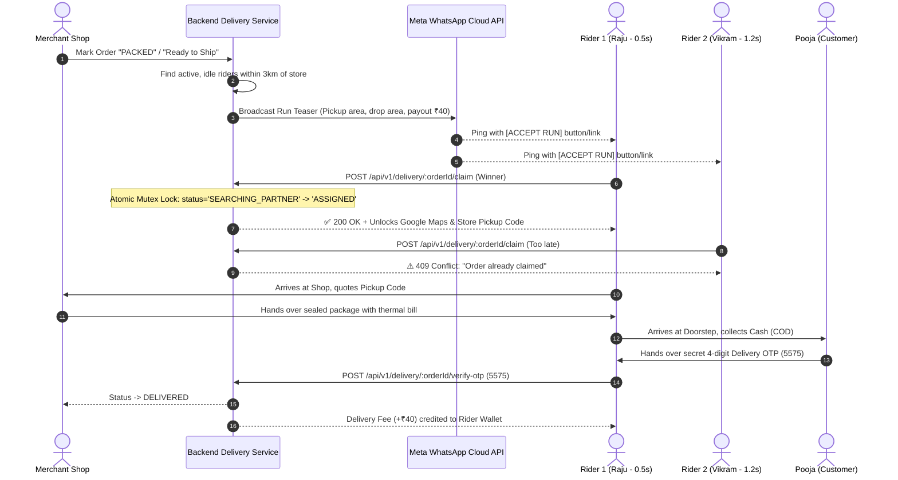

# 🛵 Hyperlocal Rider Fleet Pool Broadcast & Atomic Claim Engine
## Architectural Specification & Implementation Plan

---

### 1. Executive Summary & Objective
Transform the current 1-to-1 targeted delivery dispatch into an autonomous, shared **Zomato/Swiggy-style Rider Fleet Pool** for Indian hyperlocal markets (e.g., Bhilai, Durg, Raipur).
- **Core Problem Solved:** Eliminates the burden on local brick-and-mortar merchants to hire or manage delivery staff.
- **Concurrency Guarantee:** Broadcasts open runs to nearby active platform riders while mathematically guaranteeing that **exactly one rider** can claim the assignment using an atomic database mutex (`findOneAndUpdate`).

---

### 2. End-to-End Operational Lifecycle



---

### 3. Concrete Implementation Phases

#### Phase A: Backend Delivery Pool & Mutex Engine (`apps/backend`)
1. **Extend `DeliveryModel` (`apps/backend/src/modules/delivery/delivery.model.ts`)**:
   - Add `broadcastRiderPool: Array<{ riderId: string; pingedAt: Date }>`
   - Add `claimExpiresAt: Date` (60-second time-to-live for pool claims)
   - Add `pickupVerificationCode: string` (e.g. `PICKUP-79`)
2. **Atomic Claim Service & Route (`POST /api/v1/delivery/:orderId/claim`)**:
   ```typescript
   async function claimDeliveryRun(orderId: string, riderId: string): Promise<ClaimResult> {
     const claimed = await DeliveryModel.findOneAndUpdate(
       {
         orderId,
         status: DeliveryStatus.SEARCHING_PARTNER,
         rider: null,
       },
       {
         $set: {
           status: DeliveryStatus.ASSIGNED,
           rider: riderSnapshot,
           assignedAt: new Date(),
         },
       },
       { new: true }
     );
     if (!claimed) {
       throw AppError.conflict('Order already claimed by another partner', 'ALREADY_CLAIMED');
     }
     return { success: true, delivery: claimed };
   }
   ```
3. **Automated WhatsApp Interactive Broadcast**:
   - Update `whatsapp.service.ts` to format WhatsApp interactive message template with a Quick Reply button: `[ 🟢 ACCEPT RUN ]` or short-link URL (`https://delivery.platform.in/claim/:token`).

---

#### Phase B: Mobile-Optimized Rider Claim & Verification View
1. **Lightweight Mobile Web Interface (`apps/web` or dedicated PWA route `/delivery/claim/[token]`)**:
   - Screen 1: **One-Tap Claim Button** showing Store Name, Drop Neighborhood, Distance, and Payout (₹40).
   - Screen 2: **Active Run Dashboard** (Once claimed):
     - Direct *"Open in Google Maps"* button (`travelmode=two-wheeler`).
     - Store Pickup Code to show shopkeeper (`PICKUP-79`).
     - Customer Call Button.
     - 4-Digit OTP entry input to complete delivery at the doorstep.
   - Screen 3: **Already Claimed Zero-State** with friendly notification if another rider tapped first.

---

#### Phase C: Rider Ledger & Earnings Reconciliation
1. **Rider Wallet Balance (`rider_wallets` collection)**:
   - Track delivery payouts: `+₹40` per completed delivery.
   - Track Cash on Delivery (COD) in-hand: `+₹838.95` collected cash liability.
   - Daily end-of-day cash sweep / settlement calculation.

---

### 4. Technical Invariants
- **Zero Client Brand Hardcoding:** All rider notifications and claim screens dynamically pull from `branding.config.ts`.
- **Zero Customer Address Leaks:** Drop-off building name and phone number are strictly withheld until the atomic lock is won.
- **Zero Double-Delivery:** Enforced mathematically at MongoDB query level via ACID atomic filter matching.
